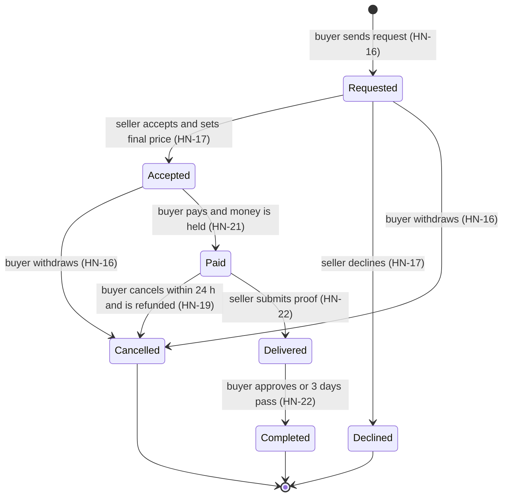
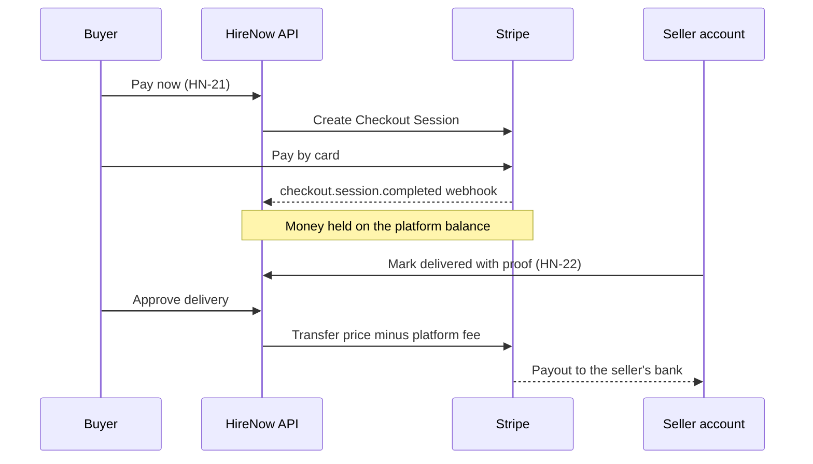

# HireNow · Product backlog

> This file seeds the GitHub backlog. [`scripts/create_github_backlog.py`](../scripts/create_github_backlog.py) turns every epic (`## E…`) and backlog item (`### HN-…`) below into a GitHub issue. Once the issues exist, **the GitHub Project is the live backlog**. Return to this file only for a major re-plan.

The original user stories and their IDs (SP-xx, SS-xx, AD-xx) are in [USER_STORIES.md](USER_STORIES.md). Technical choices are in [TECH_STACK.md](TECH_STACK.md). How we work with the backlog on GitHub is in [GITHUB_BACKLOG.md](GITHUB_BACKLOG.md).

## At a glance

| | Items | Story points |
|---|---|---|
| Must have (the MVP) | 20 | 72 |
| Should have | 10 | 28 |
| Could have | 3 | 11 |
| **Total** | **33** | **111** |
| Planned in Sprints 1–5 | 22 | 76 |

## Capacity and estimation

- **Team:** 5 people, 5 one-week sprints, **40 hours per week for the whole team** (about 8 h per person), so 200 h in total.
- **Scrum events** take about 1.5 h per person per week: planning 30 min, review 20 min, retro 20 min, three 5-minute stand-ups and a share of refinement. That leaves **about 32 focused hours per sprint**.
- **Estimates** use story points on the Fibonacci scale (1, 2, 3, 5, 8). We start with **1 SP ≈ 2 focused hours**, so the target is **about 16 SP per sprint, or about 80 SP in total**. Recalibrate after Sprint 1 using the real velocity.
- An item estimated at 8 SP must be split before it enters a sprint.
- **What this means:** the Must-haves (72 SP) use almost all of the capacity. Should and Could items are ordered in the stretch list below and are pulled in only if the team turns out to be faster.

## Sprint plan

| Sprint | Goal | Items | SP |
|---|---|---|---|
| Sprint 1 | Walking skeleton: the app runs locally and in CI, GCP is ready, users can register and sign in | HN-01, HN-02, HN-03, HN-05 | 15 |
| Sprint 2 | Sellers can publish: the app is deployed and sellers can create, illustrate and edit listings | HN-04, HN-06, HN-07, HN-08, HN-09 | 15 |
| Sprint 3 | Buyers can find and request: search, seller profile pages, the request and accept flow, order history | HN-10, HN-13, HN-16, HN-17, HN-18 | 16 |
| Sprint 4 | Talk and pay: chat, Stripe onboarding, paying with the money held, favourites | HN-20, HN-21, HN-27, HN-14 | 15 |
| Sprint 5 | Close the loop: delivery and payout, reviews, admin moderation, seller terms, final demo | HN-22, HN-28, HN-30, HN-12 | 15 |

**How to staff a sprint.** Work in vertical slices: each item has one owner who takes it to Done, pairing backend and frontend work where needed. In Sprint 1, one person owns HN-03 (GCP) while the others build HN-01, HN-02 and HN-05.

**Key dependencies.** Everything needs HN-01 and HN-05. HN-04 needs HN-03. HN-10 and HN-13 share the service card component. HN-17 needs HN-16. HN-22 needs HN-20 and HN-21. HN-28 needs completed orders from HN-22, but can be built in parallel against seeded data.

## Stretch list

Pull these in this order when the team is ahead of plan.

| # | Item | Priority | SP | Why here |
|---|---|---|---|---|
| 1 | HN-19 Cancel an order within the cancellation window | Should | 3 | Buyer protection; reuses Stripe from HN-21 |
| 2 | HN-31 Platform statistics | Should | 3 | Admin story with high demo value |
| 3 | HN-29 Review a client | Should | 2 | Small; reuses review code from HN-28 |
| 4 | HN-11 Add a video to a listing | Should | 2 | Small; reuses media upload from HN-08 |
| 5 | HN-25 Send a contract | Should | 3 | Ship together with HN-26 |
| 6 | HN-26 Sign a contract | Should | 3 | |
| 7 | HN-24 Invoice when an order is paid | Should | 3 | Shares the PDF setup with contracts |
| 8 | HN-32 Feedback and complaints inbox | Should | 5 | Largest Should; a support email in the footer covers it until then |
| 9 | HN-33 In-app notifications | Could | 3 | |
| 10 | HN-15 Follow sellers | Could | 3 | Its notification part needs HN-33 |
| 11 | HN-23 Deposit and balance payment option | Could | 5 | The most complex payment change |

## Won't have in this release

- Native mobile apps (the web app is responsive instead)
- Multiple currencies or languages
- Legally binding e-signatures (HN-26 is click-to-sign)
- Live payments: Stripe stays in test mode
- Dispute arbitration beyond the complaints inbox
- Seller subscription plans or promoted listings

## Definition of Ready

An item can enter a sprint when:

- it has an ID, a user story sentence and testable acceptance criteria;
- it is estimated at 5 SP or less (anything at 8 must be split);
- its dependencies are done, or planned earlier in the same sprint;
- the team understands it well enough to split it into tasks.

## Definition of Done

- The acceptance criteria are met and shown at the sprint review.
- The code is merged to `main` through a reviewed PR (1 approval) and CI is green.
- Business rules (validation, permissions, state changes) are covered by tests.
- Database changes ship as EF Core migrations, and new endpoints appear in the OpenAPI docs.
- It is deployed to the GCP production environment (from Sprint 2 onwards).
- No secrets are committed, and the issue is closed.

## Epics and stories

## E0 · Foundation & DevOps

Technical enablers that every feature depends on. They don't deliver a feature by themselves, but they make the product buildable, testable and deployable from week 2.

### HN-01 · Set up the repository, solution skeleton and team conventions

| Type | Priority | Points | Sprint | Traces to | Labels |
|---|---|---|---|---|---|
| Enabler | Must | 3 | 1 | — | area:backend, area:frontend, area:devops |

**As a** developer, **I want** a ready-to-run project skeleton, **so that** the whole team builds features in the same structure from day one.

**Acceptance criteria**
- `backend/` contains an ASP.NET Core (.NET 10) Web API solution split into `Api`, `Application`, `Domain`, `Infrastructure` and `Tests` projects, and `GET /health` returns 200.
- `frontend/` contains a React + TypeScript app (Vite) with routing, an API client, ESLint and Prettier.
- `docker compose up` starts SQL Server 2022, the API and the frontend locally, and the README explains how to run it.
- EF Core is configured with an initial migration that seeds the service categories, and the OpenAPI UI is available in Development.
- `main` is protected: changes only through PRs with 1 approval.

**Tasks**
- [ ] BE: create the solution, projects and health endpoint
- [ ] BE: add EF Core with the SQL Server provider, an initial migration and category seed data
- [ ] FE: scaffold the Vite React TS app with React Router and TanStack Query
- [ ] DevOps: `docker-compose.yml` (SQL Server, API, frontend) and `.env.example`
- [ ] DevOps: branch protection and CODEOWNERS
- [ ] Docs: a "Getting started" section in the README

### HN-02 · Continuous integration with GitHub Actions

| Type | Priority | Points | Sprint | Traces to | Labels |
|---|---|---|---|---|---|
| Enabler | Must | 2 | 1 | — | area:devops |

**As a** developer, **I want** every pull request built and tested automatically, **so that** broken code never reaches `main`.

**Acceptance criteria**
- A workflow runs on every PR and on every push to `main`.
- The backend job runs `dotnet restore`, `build` and `test`; any failing test fails the PR.
- The frontend job runs `npm ci`, `lint`, `test` and `build`.
- Both checks are required in the `main` branch protection rules.
- NuGet and npm caching keep a typical run under about 5 minutes.

**Tasks**
- [ ] `.github/workflows/ci.yml` with backend and frontend jobs
- [ ] One sample unit test per side so the pipeline has something to run
- [ ] Mark both checks as required on `main`

**Depends on:** HN-01

### HN-03 · Provision the GCP environment

| Type | Priority | Points | Sprint | Traces to | Labels |
|---|---|---|---|---|---|
| Enabler | Must | 5 | 1 | — | area:devops |

**As the** team, **I want** a production environment on Google Cloud, **so that** we can deploy and demo the app from week 2.

**Acceptance criteria**
- A GCP project exists with billing, a budget alert, and every teammate added with least-privilege roles.
- A Cloud SQL for SQL Server instance (Express edition, smallest tier) with a `hirenow` database is reachable from Cloud Run.
- An Artifact Registry repository holds API images, and a Cloud Storage bucket holds listing media.
- The database connection string, JWT signing key and Stripe keys are in Secret Manager. None are in git.
- A Firebase Hosting site exists for the frontend.
- GitHub Actions authenticates to GCP through Workload Identity Federation, with no JSON service-account keys.
- All setup steps are documented as `gcloud` commands in `docs/infra.md`.

**Tasks**
- [ ] Create the project and enable the Cloud Run, Cloud SQL Admin, Artifact Registry, Secret Manager, Cloud Storage and IAM Credentials APIs
- [ ] Budget alerts at 50% and 90% of the available credits
- [ ] Cloud SQL instance, database and app user, plus networking (private IP with Direct VPC egress, or the Cloud SQL Auth Proxy)
- [ ] Storage bucket with CORS configured for browser uploads
- [ ] Secret Manager entries
- [ ] Workload Identity pool, provider and deploy service account
- [ ] Firebase Hosting site
- [ ] Write `docs/infra.md`

### HN-04 · Continuous deployment to GCP

| Type | Priority | Points | Sprint | Traces to | Labels |
|---|---|---|---|---|---|
| Enabler | Must | 3 | 2 | — | area:devops |

**As the** team, **I want** every merge to `main` deployed automatically, **so that** the latest version is always available for review and demo.

**Acceptance criteria**
- On a push to `main`, once CI passes, the API image is built, pushed to Artifact Registry and deployed to Cloud Run.
- EF Core migrations are applied (as a migration bundle) before the new revision receives traffic.
- The frontend is built against the production API URL and deployed to Firebase Hosting.
- A failed deploy leaves the running version untouched, and the workflow log shows which step failed.
- The production URLs are listed in the README.

**Tasks**
- [ ] Multi-stage Dockerfile for the API
- [ ] `.github/workflows/deploy.yml` using `google-github-actions/auth` and `deploy-cloudrun`
- [ ] EF Core migration bundle step
- [ ] Firebase Hosting deploy step
- [ ] CORS configuration for the frontend origin

**Depends on:** HN-02, HN-03

## E1 · Accounts & profiles

These aren't in the original user stories, but every story needs signed-in users who have a role: seller, buyer or admin.

### HN-05 · Register and sign in as a seller or a buyer

| Type | Priority | Points | Sprint | Traces to | Labels |
|---|---|---|---|---|---|
| Story | Must | 5 | 1 | Prerequisite for all stories | role:seller, role:buyer |

**As a** visitor, **I want** to create an account as a service provider or a service seeker and sign in, **so that** I can use the features for my role.

**Acceptance criteria**
- Given a new email address, when I register with a password and choose "Service provider" or "Service seeker", then my account is created with that role and I am signed in.
- Passwords are hashed by ASP.NET Core Identity, and weak passwords are rejected with a clear message.
- Signing in with valid credentials returns a token. Invalid credentials show a generic error that doesn't reveal whether the email exists.
- API endpoints are protected by `Seller`, `Buyer` and `Admin` policies, and an admin account is seeded from configuration.
- I can sign out, and the frontend hides pages my role can't use.

**Tasks**
- [ ] BE: ASP.NET Core Identity with EF Core stores and bearer-token endpoints
- [ ] BE: roles, authorization policies and admin seeding
- [ ] FE: register, sign-in and sign-out pages; an auth context; protected routes
- [ ] Tests: registration, sign-in and role authorization

**Depends on:** HN-01

### HN-06 · Manage my profile

| Type | Priority | Points | Sprint | Traces to | Labels |
|---|---|---|---|---|---|
| Story | Must | 2 | 2 | SP-03 | role:seller, role:buyer |

**As a** user, **I want** to edit my profile, **so that** the people I deal with know who I am.

**Acceptance criteria**
- I can update my display name, bio (up to 1,000 characters), location and profile photo.
- The photo is stored in Cloud Storage. Only JPG, PNG or WebP files up to 5 MB are accepted.
- Seller profiles are public. Buyer profiles are visible only to signed-in sellers.

**Tasks**
- [ ] BE: profile endpoints
- [ ] BE: reusable Cloud Storage upload service with signed URLs (shared with HN-08)
- [ ] FE: edit profile page

**Depends on:** HN-05

## E2 · Service listings

Sellers present, publish and maintain their services. Covers SP-01, SP-02 (the listing part), SP-03, SP-04 and SP-06.

### HN-07 · Create and publish a service listing with a price range

| Type | Priority | Points | Sprint | Traces to | Labels |
|---|---|---|---|---|---|
| Story | Must | 5 | 2 | SP-01, SP-02 | role:seller |

**As a** service provider, **I want** to create a listing with a title, description, category, tags and a price range, **so that** clients understand what I offer and what it costs.

**Acceptance criteria**
- Required fields: title (up to 100 characters), description (Markdown, up to 5,000 characters), category, minimum price and maximum price. Both prices must be greater than 0, and the minimum can't exceed the maximum.
- Optional fields: up to 10 tags and an estimated delivery time in days.
- I can save a listing as a Draft or Publish it. Only Published listings appear in search and on my profile.
- Validation errors appear next to the field that caused them.
- Only the seller who owns a listing can change it. Anyone else gets a 403.

**Tasks**
- [ ] BE: `Service`, `Category` and `Tag` entities and a migration
- [ ] BE: create and read endpoints with FluentValidation
- [ ] FE: create listing form with Save draft and Publish
- [ ] FE: service detail page
- [ ] Tests: validation and ownership rules

**Depends on:** HN-05

### HN-08 · Add photos to a listing

| Type | Priority | Points | Sprint | Traces to | Labels |
|---|---|---|---|---|---|
| Story | Must | 3 | 2 | SP-01 | role:seller |

**As a** service provider, **I want** to add photos to my listing, **so that** clients can see examples of my work.

**Acceptance criteria**
- I can upload up to 10 images (JPG, PNG or WebP, up to 5 MB each) and choose one as the cover.
- Images go straight to Cloud Storage through signed URLs. The API stores only their metadata.
- I can reorder and remove images.
- The cover image appears on service cards. All images appear in a gallery on the service page.

**Tasks**
- [ ] BE: signed upload URL endpoint and a media metadata entity
- [ ] FE: multi-file upload with progress, cover selection and reordering
- [ ] FE: image gallery on the service page
- [ ] Tests: file type and size validation on both sides

**Depends on:** HN-07

### HN-09 · Edit, unpublish or delete my service

| Type | Priority | Points | Sprint | Traces to | Labels |
|---|---|---|---|---|---|
| Story | Must | 2 | 2 | SP-06 | role:seller |

**As a** service provider, **I want** to edit my services, **so that** my listings stay accurate when something changes.

**Acceptance criteria**
- I can edit every field from HN-07 and the photos. Changes are visible as soon as I save.
- I can unpublish a listing, which hides it from search but keeps it for existing orders, and republish it later.
- I can delete a listing only if it has no active orders. Otherwise I'm asked to unpublish it instead.
- Existing orders keep the price agreed when they were accepted.

**Tasks**
- [ ] BE: update, unpublish and delete endpoints with these rules
- [ ] FE: a "My services" page with edit, unpublish and delete actions
- [ ] Tests: the delete and unpublish rules

**Depends on:** HN-07

### HN-10 · Show all my services on my public profile

| Type | Priority | Points | Sprint | Traces to | Labels |
|---|---|---|---|---|---|
| Story | Must | 3 | 3 | SP-03 | role:seller |

**As a** service provider, **I want** all my services listed under my profile, **so that** clients find everything I offer in one place.

**Acceptance criteria**
- `/sellers/{id}` shows the seller's profile, average rating, number of completed orders and all their Published services as cards.
- Each card shows the cover image, title, price range and rating, and links to the service page.
- Every service page links back to the seller's profile.
- Draft and unpublished services are visible only to their owner, under "My services".

**Tasks**
- [ ] BE: public seller profile endpoint
- [ ] FE: seller profile page
- [ ] FE: reusable service card component (also used by HN-13)

**Depends on:** HN-06, HN-07

### HN-11 · Add a video to a listing

| Type | Priority | Points | Sprint | Traces to | Labels |
|---|---|---|---|---|---|
| Story | Should | 2 | Stretch | SP-01 | role:seller |

**As a** service provider, **I want** to add a video to my listing, **so that** I can show my work in action.

**Acceptance criteria**
- I can upload one MP4 or WebM video up to 100 MB, using the same signed-URL upload as HN-08, or paste a YouTube or Vimeo link instead.
- The video plays on the service page and never autoplays with sound.
- The upload shows progress, and gives a clear error if the file is too large or the wrong type.

**Tasks**
- [ ] BE: allow a video media type and enforce its size limit
- [ ] FE: video upload or link field, and the player on the service page

**Depends on:** HN-08

### HN-12 · Publish my Terms of Service for clients

| Type | Priority | Points | Sprint | Traces to | Labels |
|---|---|---|---|---|---|
| Story | Should | 2 | 5 | SP-04 | role:seller |

**As a** service provider, **I want** clients to be able to read my Terms of Service easily, **so that** expectations are clear before they order.

**Acceptance criteria**
- I write my Terms of Service once in my seller settings (Markdown, up to 10,000 characters).
- A "Terms of Service" link on my profile and on each of my service pages opens them.
- A client requesting one of my services must tick "I have read the seller's terms" before sending the request.
- A platform-wide Terms of Service page is linked in the site footer.

**Tasks**
- [ ] BE: store seller terms and record the client's acceptance on the order
- [ ] FE: terms editor in seller settings, a terms modal, and the checkbox on the request form
- [ ] Content: the static platform terms page

**Depends on:** HN-16

## E3 · Discovery

Buyers find services, and sellers get found. Covers SS-01, SP-09, SS-02 and SS-07.

### HN-13 · Search services by keyword and filters

| Type | Priority | Points | Sprint | Traces to | Labels |
|---|---|---|---|---|---|
| Story | Must | 5 | 3 | SS-01, SP-09 | role:buyer |

**As a** service seeker, **I want** to search by keyword and filter the results, **so that** I quickly find the service I need, and sellers get found by the right clients.

**Acceptance criteria**
- A search box on every page matches keywords in titles, descriptions and tags, ignoring case.
- Filters for category, price range, minimum rating and maximum delivery time can be combined.
- Results can be sorted by relevance, newest, price (low to high or high to low) and rating.
- Results are paginated (20 per page) as service cards. When there are no results, the page suggests clearing filters.
- The query and filters are kept in the URL, so a search can be bookmarked or shared.
- Only Published services from active sellers appear.
- With 1,000 seeded services, results return in under 1 second.

**Tasks**
- [ ] BE: search endpoint (EF Core query) and database indexes
- [ ] BE: seed script that generates about 1,000 realistic services
- [ ] FE: search page with filters, sorting and pagination
- [ ] FE: category tiles on the home page that link to a filtered search

**Depends on:** HN-07, HN-10

### HN-14 · Save services to my favourites

| Type | Priority | Points | Sprint | Traces to | Labels |
|---|---|---|---|---|---|
| Story | Should | 2 | 4 | SS-02 | role:buyer |

**As a** service seeker, **I want** to save services, **so that** I can easily come back to them.

**Acceptance criteria**
- A save (heart) button on service cards and service pages adds or removes the service. Guests are asked to sign in first.
- A "Saved services" page lists them, newest first. Services that are no longer published are marked as unavailable.
- Saving the same service twice has no effect, and I can remove a service from the list.

**Tasks**
- [ ] BE: favourites entity and endpoints
- [ ] FE: save button and "Saved services" page

**Depends on:** HN-10

### HN-15 · Follow sellers and see their new services

| Type | Priority | Points | Sprint | Traces to | Labels |
|---|---|---|---|---|---|
| Story | Could | 3 | Stretch | SS-07 | role:buyer |

**As a** service seeker, **I want** to follow sellers, **so that** I keep up with what they publish.

**Acceptance criteria**
- A Follow / Unfollow button is on every seller profile, and the profile shows the follower count.
- A "Following" page lists the sellers I follow and a feed of their newest published services.
- If HN-33 is done, I get a notification when a followed seller publishes a new service.

**Tasks**
- [ ] BE: follow relationship and feed endpoint
- [ ] FE: follow button and "Following" page

**Depends on:** HN-10

## E4 · Orders

The order lifecycle that turns a buyer's request into a completed job. Covers SP-07, SS-03 and SS-06.

### HN-16 · Request a service from a seller

| Type | Priority | Points | Sprint | Traces to | Labels |
|---|---|---|---|---|---|
| Story | Must | 3 | 3 | SP-07, SS-03 | role:buyer |

**As a** service seeker, **I want** to send a request for a service with my requirements, **so that** the seller can confirm the job and the final price.

**Acceptance criteria**
- On a service page, a signed-in buyer can click "Request this service" and describe their requirements (up to 2,000 characters), with an optional desired deadline. This creates an order in the Requested state.
- The request appears straight away in the seller's request list (HN-17) and in the buyer's order history (HN-18).
- A buyer can't have two open requests for the same service.
- The buyer can withdraw a request at any time before paying, which moves it to Cancelled.

**Tasks**
- [ ] BE: `Order` entity with a state machine that enforces the transitions in the E4 order lifecycle diagram
- [ ] BE: create and withdraw endpoints
- [ ] FE: request form on the service page
- [ ] Tests: allowed and forbidden state transitions

**Depends on:** HN-07

### HN-17 · Accept or decline client requests

| Type | Priority | Points | Sprint | Traces to | Labels |
|---|---|---|---|---|---|
| Story | Must | 3 | 3 | SP-07 | role:seller |

**As a** service provider, **I want** to manage incoming requests, **so that** I decide which jobs I take and at what price.

**Acceptance criteria**
- A "Requests" page lists my incoming requests, newest first, and can be filtered by status.
- Accepting a request means setting the final price (within my listing's price range) and a delivery date. The order moves to Accepted and the buyer is prompted to pay.
- Declining a request takes an optional reason. The order moves to Declined and the buyer sees the reason.
- Only Requested orders can be accepted or declined. Any other transition returns 409.
- The navigation shows a badge with the number of new requests.

**Tasks**
- [ ] BE: accept and decline endpoints
- [ ] FE: requests page with accept and decline dialogs, and the badge

**Depends on:** HN-16

### HN-18 · See my order history

| Type | Priority | Points | Sprint | Traces to | Labels |
|---|---|---|---|---|---|
| Story | Must | 2 | 3 | SS-06 | role:buyer, role:seller |

**As a** service seeker, **I want** to see every service I've ordered, **so that** I can track current orders and look back at past ones.

**Acceptance criteria**
- "My orders" lists every order with the service, seller, price, date and status, newest first, filterable by Active, Completed or Cancelled.
- The order detail page shows a timeline of status changes with timestamps, plus the next action (for example "Pay now", "Approve delivery" or "Leave a review").
- Sellers get the same views for the orders they have received.

**Tasks**
- [ ] BE: order list and order detail endpoints, including the status history
- [ ] FE: "My orders" page and order detail page with the timeline

**Depends on:** HN-16

### HN-19 · Cancel an order within the cancellation window

| Type | Priority | Points | Sprint | Traces to | Labels |
|---|---|---|---|---|---|
| Story | Should | 3 | Stretch | SS-03 | role:buyer |

**As a** service seeker, **I want** to cancel a paid order within a period of time, **so that** I'm not locked in if my plans change.

**Acceptance criteria**
- I can cancel a Paid order within 24 hours of paying (the window is configurable), as long as the seller hasn't marked it Delivered. I get a full refund through Stripe.
- After the window closes, the Cancel button is hidden and the page explains why, with a pointer to support.
- The order moves to Cancelled, the seller sees the cancellation, and the held money is never transferred.

**Tasks**
- [ ] BE: cancel endpoint with the window check and a Stripe refund
- [ ] FE: cancel button, confirmation dialog and explanation once the window has closed
- [ ] Tests: inside the window, outside it, and after delivery

**Depends on:** HN-21

## E5 · Payments

Stripe Connect, in test mode. The buyer pays HireNow, the money is held on the platform balance, and it is transferred to the seller once the buyer approves the delivery (Stripe's "separate charges and transfers" model). Covers SS-08 and SP-10.

### HN-20 · Connect a Stripe account to receive payouts

| Type | Priority | Points | Sprint | Traces to | Labels |
|---|---|---|---|---|---|
| Story | Must | 3 | 4 | SP-10 | role:seller |

**As a** service provider, **I want** to connect my payout account, **so that** I get paid for completed orders.

**Acceptance criteria**
- A "Payouts" settings page starts Stripe-hosted onboarding for an Express connected account and returns to the app when it's done.
- The app stores the connected account ID and shows its status (Not connected, Pending or Active), kept up to date by the `account.updated` webhook.
- A seller can't accept a request (HN-17) until payouts are Active. They see a link to finish onboarding instead.
- The whole flow works in Stripe test mode with test data.

**Tasks**
- [ ] BE: Stripe.net setup and an account-link endpoint
- [ ] BE: webhook endpoint with signature verification
- [ ] FE: payouts settings page
- [ ] Docs: using the Stripe CLI to forward webhooks locally

**Depends on:** HN-17

### HN-21 · Pay for an accepted order and have the money held

| Type | Priority | Points | Sprint | Traces to | Labels |
|---|---|---|---|---|---|
| Story | Must | 5 | 4 | SS-08, SP-10 | role:buyer |

**As a** service seeker, **I want** to pay securely for an accepted order and have the money held until the work is done, **so that** I never pay for work that isn't delivered.

**Acceptance criteria**
- "Pay now" on an Accepted order opens Stripe Checkout for the agreed price, with card payments plus Apple Pay and Google Pay where Stripe offers them.
- When the `checkout.session.completed` webhook arrives, the order moves to Paid. The money stays on the platform balance and is not sent to the seller.
- The webhook's signature is verified and processing is idempotent: replaying an event changes nothing.
- An abandoned checkout leaves the order in Accepted, and the buyer can try again.
- Both parties see "Payment held by HireNow" on the order.

**Tasks**
- [ ] BE: create a Checkout Session for an order
- [ ] BE: handle `checkout.session.completed`, idempotently
- [ ] FE: Pay now button, plus success and cancel return pages
- [ ] Tests: webhook handling, including replays

**Depends on:** HN-17

### HN-22 · Deliver proof of completion and release the payment

| Type | Priority | Points | Sprint | Traces to | Labels |
|---|---|---|---|---|---|
| Story | Must | 5 | 5 | SS-08 | role:seller, role:buyer |

**As a** service seeker, **I want** my payment to reach the seller only after proof of completion, **so that** I'm protected. The seller, in turn, is paid as soon as I confirm.

**Acceptance criteria**
- On a Paid order, the seller can click "Mark as delivered" with a message and at least one proof: a file up to 20 MB or a link. The order moves to Delivered.
- The buyer can click "Approve". The order moves to Completed and a Stripe Transfer of the price minus the platform fee (10% by default) goes to the seller's connected account.
- If the buyer hasn't responded within 3 days of delivery, the order completes automatically. A daily Cloud Scheduler job triggers this.
- If a transfer fails, it is logged and retried, and the order shows "Payout pending" until it succeeds.
- Disagreements are handled in the chat (HN-27) or through a complaint (HN-32).

**Tasks**
- [ ] BE: deliver and approve endpoints, and storage for the proof
- [ ] BE: Stripe Transfer with a configurable platform fee
- [ ] BE: protected auto-complete endpoint, plus the Cloud Scheduler job that calls it
- [ ] FE: delivery form for the seller, and the approve action for the buyer
- [ ] Tests: approval, auto-complete and a failed transfer

**Depends on:** HN-20, HN-21

### HN-23 · Choose when clients pay: full upfront or a deposit

| Type | Priority | Points | Sprint | Traces to | Labels |
|---|---|---|---|---|---|
| Story | Could | 5 | Stretch | SP-10 | role:seller |

**As a** service provider, **I want** to offer different payment options, **so that** my clients and I can agree on when the job is paid.

**Acceptance criteria**
- For each service I choose either "Full payment upfront" (the default) or "Deposit + balance", with a deposit between 10% and 90%.
- With a deposit, the buyer pays the deposit when the order is accepted, and the seller receives it once the cancellation window has passed. The buyer pays the balance on delivery, and it is released on approval, as in HN-22.
- The payment methods offered are the ones enabled in Stripe Checkout.
- The order page shows the amounts already paid and still due.

**Tasks**
- [ ] BE: payment plan on the service and partial payments on the order
- [ ] FE: payment option settings and the amounts on the order page

**Depends on:** HN-22

## E6 · Contracts & invoices

Written agreements and records. Covers SP-02 (invoices), SP-05 and SS-04. These are all Should items, so they come after the core order and payment flow.

### HN-24 · Generate an invoice when an order is paid

| Type | Priority | Points | Sprint | Traces to | Labels |
|---|---|---|---|---|---|
| Story | Should | 3 | Stretch | SP-02 | role:seller |

**As a** service provider, **I want** an invoice created when the client pays, **so that** we both have a proper record of the deal.

**Acceptance criteria**
- When an order moves to Paid, a PDF invoice is generated. It shows an invoice number (sequential per seller), the seller's and buyer's details, the service, the agreed price, the platform fee and the date.
- Both the buyer and the seller can download it from the order page.
- The invoice is stored in Cloud Storage and can't be changed once created.

**Tasks**
- [ ] BE: invoice generation with QuestPDF
- [ ] BE: billing details on the seller profile
- [ ] FE: download link on the order page

**Depends on:** HN-21

### HN-25 · Send a contract to a client

| Type | Priority | Points | Sprint | Traces to | Labels |
|---|---|---|---|---|---|
| Story | Should | 3 | Stretch | SP-05 | role:seller |

**As a** service provider, **I want** to send a contract to my client, **so that** the scope, price, deadline and terms are agreed in writing.

**Acceptance criteria**
- On an Accepted order, I can create a contract from a template that is prefilled with the service, scope (editable), price, delivery date and my Terms of Service.
- When I send it, the buyer sees it on the order page and it has the status Sent.
- If I mark the contract as required, the buyer can't pay until they have signed it.
- I can withdraw, edit and resend a contract until it is signed.

**Tasks**
- [ ] BE: contract entity, template and endpoints
- [ ] FE: contract editor and its status on the order page

**Depends on:** HN-17

### HN-26 · Sign a contract sent by a seller

| Type | Priority | Points | Sprint | Traces to | Labels |
|---|---|---|---|---|---|
| Story | Should | 3 | Stretch | SS-04 | role:buyer |

**As a** service seeker, **I want** to sign a contract I've been sent, **so that** the agreement is confirmed for both of us.

**Acceptance criteria**
- I can read the contract and sign it by typing my full name and ticking "I agree". The app records my name, the timestamp and my IP address.
- Once signed, the contract is locked, and both parties can download a PDF that includes the signature block.
- I can decline the contract and give a reason. The seller sees it on the order.
- This is a click-to-sign record for the lab, not a qualified e-signature.

**Tasks**
- [ ] BE: sign and decline endpoints, and the signed PDF (QuestPDF)
- [ ] FE: contract viewer with signing

**Depends on:** HN-25

## E7 · Messaging & notifications

Covers SP-08 and the notification part of SS-07.

### HN-27 · Chat with sellers and clients before and after ordering

| Type | Priority | Points | Sprint | Traces to | Labels |
|---|---|---|---|---|---|
| Story | Must | 5 | 4 | SP-08 | role:seller, role:buyer |

**As a** service provider, **I want** to talk with potential clients before and after they pay, **so that** I can answer their questions and coordinate the work.

**Acceptance criteria**
- A signed-in buyer can click "Contact seller" on a service page or seller profile. This opens their existing 1:1 conversation with that seller, or starts one.
- Messages arrive in real time through SignalR. Someone who is offline sees new messages on their next visit, with an unread badge.
- The conversation list shows the other person, the last message and the unread count. Older messages load page by page.
- The related order page links to the conversation.
- Only the two participants can read a conversation.
- Messages are text only, up to 2,000 characters.

**Tasks**
- [ ] BE: `Conversation` and `Message` entities and REST endpoints for history
- [ ] BE: authenticated SignalR hub
- [ ] FE: conversation list and chat window
- [ ] DevOps: Cloud Run session affinity and timeout settings for WebSockets

**Depends on:** HN-05

### HN-33 · In-app notifications

| Type | Priority | Points | Sprint | Traces to | Labels |
|---|---|---|---|---|---|
| Story | Could | 3 | Stretch | SS-07, SP-07, SP-08 | role:seller, role:buyer |

**As a** user, **I want** to be notified about events that need my attention, **so that** I don't miss requests, messages or status changes.

**Acceptance criteria**
- A bell icon shows the unread count and opens a list of notifications, each linking to the relevant page.
- Events: a new request; a request accepted or declined; payment received; an order delivered or completed; a new message (when I'm not already in that chat); a new service from a seller I follow.
- I can mark one notification, or all of them, as read.
- Notifications arrive in real time over the existing SignalR connection.

**Tasks**
- [ ] BE: notification entity and a publisher that the order, chat and follow features call
- [ ] FE: bell icon and notification list

**Depends on:** HN-27

## E8 · Reviews

Covers SP-11, SS-05 and SP-12.

### HN-28 · Review a service after a completed order

| Type | Priority | Points | Sprint | Traces to | Labels |
|---|---|---|---|---|---|
| Story | Must | 3 | 5 | SS-05, SP-11 | role:buyer |

**As a** service seeker, **I want** to review the services I've used, **so that** other people can choose better and good sellers get recognised.

**Acceptance criteria**
- Within 30 days of an order being Completed, the buyer can leave one review for it: 1 to 5 stars and a comment of up to 1,000 characters.
- Reviews appear publicly on the service page and the seller's profile, with the buyer's display name and the date, newest first.
- The average rating and the review count update on the service card, the service page and the seller profile.
- Only buyers with a completed order for that service can review it, and they can edit their review for 7 days.

**Tasks**
- [ ] BE: review entity, endpoints and the eligibility rules
- [ ] BE: average rating, kept on the service and on the seller
- [ ] FE: review form on the order page, and the review list on the service and profile pages
- [ ] Tests: who is allowed to review, and when

**Depends on:** HN-22

### HN-29 · Review a client after a completed order

| Type | Priority | Points | Sprint | Traces to | Labels |
|---|---|---|---|---|---|
| Story | Should | 2 | Stretch | SP-12 | role:seller |

**As a** service provider, **I want** to review my clients, **so that** other sellers know who they might be working with.

**Acceptance criteria**
- Once an order is Completed, the seller can rate the buyer with 1 to 5 stars and a comment, once per order.
- Client reviews are visible only to sellers (on the buyer's profile and next to their incoming requests) and to the buyer they are about. They are never public.
- The buyer's average client rating is shown next to their requests on the "Requests" page.

**Tasks**
- [ ] BE: client review entity and endpoints, with these visibility rules
- [ ] FE: review form, and the rating shown next to incoming requests

**Depends on:** HN-28

## E9 · Administration

Covers AD-01, AD-02 and AD-03.

### HN-30 · Manage users and services as an admin

| Type | Priority | Points | Sprint | Traces to | Labels |
|---|---|---|---|---|---|
| Story | Must | 5 | 5 | AD-01 | role:admin |

**As an** admin, **I want** to manage all users and the services they post, **so that** the marketplace stays safe and clean.

**Acceptance criteria**
- An admin area, accessible only to admins, has a searchable, paginated user list with name, email, role, status and join date.
- An admin can suspend or reactivate a user. Suspended users can't sign in, and their services are hidden from search.
- A searchable service list shows each service's status. An admin can hide a service, giving a reason that the seller sees, or restore it.
- Every admin action is recorded in an audit log: who did what, and when.

**Tasks**
- [ ] BE: admin endpoints for users and services
- [ ] BE: audit log entity
- [ ] FE: admin layout with the user and service tables
- [ ] Tests: only admins can reach these endpoints, and suspended users are blocked

**Depends on:** HN-05, HN-07

### HN-31 · See platform statistics

| Type | Priority | Points | Sprint | Traces to | Labels |
|---|---|---|---|---|---|
| Story | Should | 3 | Stretch | AD-02 | role:admin |

**As an** admin, **I want** statistics about the app, **so that** I can see how the marketplace is doing.

**Acceptance criteria**
- A dashboard shows users by role, new sign-ups per week, published services by category, orders by status, the value of completed orders and the platform fees earned, for the last 7, 30 or 90 days.
- At least one chart shows a trend over time (sign-ups or orders).
- The figures match the database, which is checked by tests against seeded data.
- The dashboard loads in under 2 seconds.

**Tasks**
- [ ] BE: statistics endpoint built on aggregate queries
- [ ] FE: dashboard with KPI tiles and a chart
- [ ] Tests: the figures against seeded data

**Depends on:** HN-30

### HN-32 · Collect feedback and complaints in an admin inbox

| Type | Priority | Points | Sprint | Traces to | Labels |
|---|---|---|---|---|---|
| Story | Should | 5 | Stretch | AD-03 | role:admin, role:seller, role:buyer |

**As an** admin, **I want** feedback and complaints from sellers and buyers to arrive in my inbox, **so that** I can review and resolve them.

**Acceptance criteria**
- Any signed-in user can send feedback or a complaint, with a type, subject and description, and optionally the related order or user. They can do this from a "Help & feedback" page or from an order page.
- The admin inbox lists tickets with their type, status (Open, In review or Resolved) and date, and can be filtered by status and type.
- An admin can reply and change a ticket's status. The user sees both under "My tickets".
- For a complaint about an order, the admin can see that order's timeline.

**Tasks**
- [ ] BE: ticket and reply entities and endpoints
- [ ] FE: user feedback form and "My tickets" page
- [ ] FE: admin inbox and ticket detail page

**Depends on:** HN-30
