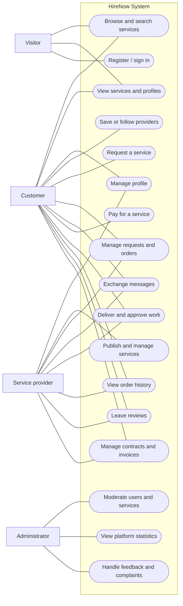

# HireNow – Requirements Document

## 1. Problem Description

People looking for freelance services often have difficulty finding suitable independent providers. Offers are scattered across social media, classified-ad websites, and various online platforms, making it difficult to compare services, prices, and customer reviews.

**HireNow** is a digital marketplace that connects customers with freelancers and independent service providers, offering a centralized platform for discovering, requesting, and purchasing services. The platform supports a wide range of services, including programming, graphic design, consulting, tutoring, photography, and home repairs, accommodating both remote and in-person work.

Customers can browse and compare offers, contact service providers, submit service requests, make secure payments, track their orders, and leave reviews. Service providers can showcase their work, publish offers, manage requests, communicate with customers, and receive payments through the platform.

The platform may also offer location-based search, enabling customers to find nearby service providers by filtering results based on city and approximate distance.

## 2. Users and Main User Categories

| Category | Description | Main needs |
|---|---|---|
| **Visitor** | A person browsing the platform without signing in. | Explore service categories, search for services, and view public offers and provider profiles. |
| **Customer** | A registered user or small business looking to hire a provider for an in-person or remote service. | Find suitable services, compare offers, contact providers, place and track orders, pay, and leave reviews. |
| **Service provider (freelancer)** | A registered user offering services for a fee. | Maintain a professional profile, publish and manage listings, handle customer requests, communicate, and receive payments. |
| **Administrator** | A user responsible for managing the platform. | Moderate user accounts and service listings, handle feedback and complaints, and review platform statistics. |

An account is registered as either a **customer** or a **service provider**. Administrator access is assigned separately.

## 3. Functional and Non-Functional Requirements

### 3.1. Functional Requirements

| ID | Functional requirement |
|---|---|
| **FR-01** | The platform allows users to create an account, sign in, and sign out, with access to features based on their role. |
| **FR-02** | Registered users can edit their profiles, including their display name, description, location, and profile picture. |
| **FR-03** | Service providers can create listings containing a title, description, category, price range, and examples of their work, including photos and optionally videos. |
| **FR-04** | Service providers can edit, publish, unpublish, and delete their own listings, subject to existing orders. |
| **FR-05** | Service providers can display their services on a public profile and publish their Terms of Service for customers to read. |
| **FR-06** | Visitors and customers can search for services using keywords and filters such as category, price, rating, and estimated delivery time. The search may also support filtering local services by city and approximate distance. |
| **FR-07** | Users can view service details, provider profiles, prices, images, and customer reviews. |
| **FR-08** | Registered customers can save services to a personal favourites list and follow service providers to discover their new offers. |
| **FR-09** | Registered customers can submit service requests describing the work they need and, optionally, their preferred deadline. |
| **FR-10** | Service providers can view, accept, or decline incoming requests. When accepting a request, they can confirm the final price and delivery date. |
| **FR-11** | Customers and service providers can view their order history and track the status of each request or order. |
| **FR-12** | Customers can withdraw requests before payment and, when eligible, cancel paid orders within the permitted cancellation period. |
| **FR-13** | Customers and service providers can communicate through private messages before and after placing an order. |
| **FR-14** | Customers can pay for accepted orders using the payment methods supported by the platform. The payment is held until the service is completed and approved. |
| **FR-15** | Service providers can submit proof of completion, and customers can approve the delivered work, allowing the platform to release the payment to the provider. |
| **FR-16** | Service providers can connect a payout account and, where supported, offer different payment arrangements, such as full upfront payment or a deposit followed by the remaining balance. |
| **FR-17** | The platform can generate invoices for paid orders, accessible to the customer and service provider. |
| **FR-18** | Service providers can send contracts to customers, who can review, accept, or decline them through a simple electronic confirmation process. |
| **FR-19** | Customers can rate and review services after a completed order. Reviews are displayed on service pages and provider profiles. |
| **FR-20** | Service providers can review customers after completed orders. These reviews are visible to the relevant customer and to service providers. |
| **FR-21** | Administrators can view and manage user accounts and published services, including suspending accounts and hiding inappropriate listings. |
| **FR-22** | Administrators can view statistics about users, services, orders, and platform activity. |
| **FR-23** | Customers and service providers can submit feedback or complaints, which administrators can review and manage. |

### 3.2. Non-Functional Requirements

| ID | Non-functional requirement |
|---|---|
| **NFR-01 – Usability** | The interface must be intuitive, allowing users to perform common operations, such as searching for services, publishing a listing, or submitting a request, without prior training. |
| **NFR-02 – Responsive design** | The web application must be usable on both desktop and mobile devices. |
| **NFR-03 – Performance** | The platform should provide fast response times and smooth operation when browsing services, searching, and interacting with its main features. |
| **NFR-04 – Security** | Passwords must be stored securely, and account, order, and administrative operations must be protected through authentication and role-based authorization. |
| **NFR-05 – Privacy** | Private messages and personal account information must only be accessible to authorized users and must not be exposed on public pages. |
| **NFR-06 – Payment integrity** | Payment confirmations and order-status changes must be processed securely and consistently, preventing unauthorized or duplicate payment releases. |
| **NFR-07 – Reliability** | Data relating to accounts, listings, orders, and reviews must be persisted reliably, and important operation failures must be communicated clearly to users. |

## 4. Product Goal

**HireNow aims to provide a single, accessible marketplace where customers can quickly discover, compare, and hire independent service providers for local, in-person or remote work, while freelancers can promote their services, communicate with customers, manage orders, and receive payments through a simple and transparent process.**

## 5. Use Case Diagram

The following diagram shows the main users and their interactions with the HireNow platform.

