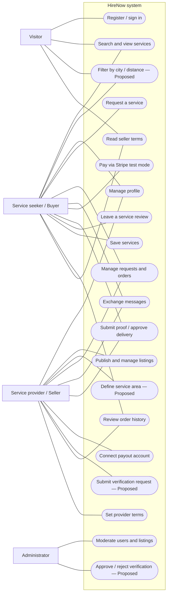

# HireNow · Requirements Document

## 1. Problem Description

People looking for local services—such as home repairs, cleaning, furniture assembly, gardening, tutoring, or photography—often struggle to find a suitable independent provider. Offers are scattered across social networks, classified-ad websites, and local groups, making it difficult to compare prices, reviews, and service coverage. For work performed at a customer's home, trust in the provider's identity is particularly important. Unlike a marketplace focused solely on digital freelance work, a local-services platform must also consider **city, service location, and distance**.

**HireNow** is a digital marketplace that connects **service seekers (buyers)** with **freelance service providers (sellers)**. It primarily targets **in-person services**, performed at the customer's location or the provider's premises, while also supporting the concept of **remote/online services**, such as graphic design or software development.

The intended experience is to discover a service, inspect its listing and provider profile, discuss the work, submit a request, agree on a price, and track the order through completion and a review. The existing backlog also includes a payment flow using **Stripe in test mode**, with payment released to the provider after delivery approval or the configured automatic-completion period.

**Scope clarification:** Location-based discovery and manual identity screening are essential elements of the intended *local-services* concept, but are **not yet represented by implementation stories in the supplied backlog**. They are explicitly marked **Proposed** below, rather than presented as committed MVP work.

## 2. Users and Main User Categories

| User category | Description | Main needs |
|---|---|---|
| **Visitor (guest)** | A person browsing HireNow without an account. | Search and explore published services, view public provider profiles, and register or sign in to request a service. |
| **Service seeker (buyer)** | An individual or small business looking to hire someone for an in-person or online service. | Find relevant providers, compare offers and reviews, contact sellers, request and track work, pay securely, and review completed services. |
| **Service provider (seller)** | A freelancer or independent contractor offering services. | Maintain a professional profile, publish listings and prices, receive requests, communicate with clients, complete work, and receive payment. For in-person work, describe the intended service area. |
| **Administrator** | A member of the HireNow team responsible for platform operations. | Moderate users and listings, enforce platform rules, and—under the proposed screening feature—review identity-verification requests. |

**Account rule:** In the current backlog, each account is created as **either a buyer or a seller**, not both; an administrator has a separate privileged role. Supporting both buyer and seller roles on a single account would require a future backlog change. (HN-05; `USER_STORIES.md`, assumption 8.)

## 3. Functional and Non-Functional Requirements

### 3.1 Functional Requirements

The **Alignment** column uses these meanings: **Planned** = included in Sprints 1–5; **Stretch** = backlog item not scheduled in those sprints; **Proposed** = not yet covered by an item in `BACKLOG.md`. Some scheduled items are *Should have*, not *Must have*; these are identified separately. The references use the existing backlog IDs (`HN-xx`) and original user-story IDs (`SP-xx`, `SS-xx`, `AD-xx`).

| ID | Functional requirement | Alignment and traceability |
|---|---|---|
| **FR-01 — Accounts and access** | Visitors can register as buyers or sellers, sign in and sign out. The system restricts actions according to the authenticated user's role. | **Planned:** HN-05 |
| **FR-02 — User profiles** | Buyers and sellers can edit their display name, biography, location, and profile photo. Seller profiles are public; buyer profiles are available only to authenticated sellers. | **Planned:** HN-06, HN-10; SP-03 |
| **FR-03 — Service listings** | Sellers can create and publish listings with a title, description, category, tags, estimated delivery time, and a valid minimum–maximum price range. Listings can also remain in draft status. | **Planned:** HN-07; SP-01, SP-02 |
| **FR-04 — Listing media** | Sellers can add, remove, reorder, and select a cover image for service listings. A video upload or external video link is optional functionality. | **Planned:** HN-08; **Stretch (Should):** HN-11; SP-01 |
| **FR-05 — Manage listings** | Sellers can edit, unpublish, republish, or delete their own listings, subject to restrictions involving active orders. Only published listings are discoverable. | **Planned:** HN-09; SP-06 |
| **FR-06 — Provider pages** | A public seller profile shows the seller's published services and, where available, completed-order counts and ratings. | **Planned:** HN-10; SP-03 |
| **FR-07 — Service format and coverage** | An in-person listing specifies the city, whether work takes place at the customer's address or provider's premises, and the provider's service area or travel radius. A remote-service listing does not require a travel radius. | **Proposed:** no current HN item; location/service-format gap |
| **FR-08 — Search and standard filters** | Visitors and buyers can search published services by keyword and apply category, price, rating, and delivery-time filters, with sorting and pagination. | **Planned:** HN-13; SP-09, SS-01 |
| **FR-09 — Location and distance search** | Users can specify a city or approximate target location and a maximum distance. For in-person work, search filters results using service coverage and available location data; distance is shown as approximate when sufficiently supported. Remote services remain discoverable without a proximity requirement. | **Proposed:** no current HN item; location-based discovery gap |
| **FR-10 — Service information** | Users can inspect service details, images, seller information, and eligible customer reviews before requesting a service. | **Planned:** HN-07, HN-08, HN-10, HN-28; SP-01, SP-03, SS-05 |
| **FR-11 — Request a service** | An authenticated buyer can send a request describing the work and optionally providing a preferred deadline. The request starts in the `Requested` state; duplicate open requests for the same service are prevented. | **Planned:** HN-16; SP-07, SS-03 |
| **FR-12 — In-person appointment details** | For an in-person request, the buyer can provide a preferred date/time window and an approximate service location. Precise address details must not be displayed in public search results. | **Proposed:** extension to HN-16; scheduling/address fields not currently specified |
| **FR-13 — Handle incoming requests** | Sellers can view requests and accept or decline them. Acceptance establishes a final price within the listing's price range and a delivery date; eligible requests move to `Accepted` or `Declined`. | **Planned:** HN-17; SP-07 |
| **FR-14 — Order history and status** | Buyers and sellers can view their relevant orders and a history of state changes, including request, acceptance, payment, delivery, completion, and cancellation where applicable. | **Planned:** HN-18; SS-06 |
| **FR-15 — Withdraw and cancel** | Buyers can withdraw requests before payment. Cancellation of a paid order, within the defined window and subject to delivery restrictions, is optional functionality. | **Planned:** HN-16; **Stretch (Should):** HN-19; SS-03 |
| **FR-16 — Direct messaging** | Authenticated buyers and sellers can exchange private text messages before or after placing an order, and open the relevant conversation from an order. | **Planned:** HN-27; SP-08 |
| **FR-17 — Seller payout setup** | Sellers can connect a Stripe Express payout account and view onboarding status. Only sellers with active payout onboarding can accept paid orders under the intended payment rules. | **Planned:** HN-20; SP-10 |
| **FR-18 — Checkout and held payment** | A buyer can pay for an accepted order through Stripe Checkout. The order becomes `Paid` after confirmed payment, while funds remain on the platform side until the release condition is met. **All payment operations in this release use Stripe test mode.** | **Planned:** HN-21; SS-08, SP-10 |
| **FR-19 — Proof, approval, and payout** | A seller can provide proof of delivery. The buyer can approve it, after which the order is completed and the seller transfer is initiated, less the platform fee (10% by default). The backlog also specifies automatic completion after three days without a buyer response. | **Planned:** HN-22; SS-08, SP-10 |
| **FR-20 — Reviews of services** | A buyer can leave one public rating and review for each eligible completed order, within the backlog's review window. Ratings are visible on service pages and seller profiles. | **Planned:** HN-28; SP-11, SS-05 |
| **FR-21 — Saved services** | Signed-in buyers can add or remove listings from a personal saved-services list. | **Planned (Should):** HN-14; SS-02 |
| **FR-22 — Seller terms** | Sellers can publish Terms of Service. Buyers must acknowledge a seller's terms when submitting a request, if the feature is delivered. | **Planned (Should):** HN-12; SP-04 |
| **FR-23 — Follow providers** | Buyers can follow or unfollow sellers and see a feed of their recently published services. | **Stretch (Could):** HN-15; SS-07 |
| **FR-24 — Alternative payment schedule** | Sellers can optionally offer a deposit plus remaining-balance arrangement in addition to full upfront payment. | **Stretch (Could):** HN-23; SP-10 |
| **FR-25 — Invoices** | The platform can generate and provide a downloadable PDF invoice when an order reaches the `Paid` state. | **Stretch (Should):** HN-24; SP-02 |
| **FR-26 — Contracts** | Sellers can send contracts for accepted orders, and buyers can accept them through a basic click-to-sign flow or decline them. This is not a qualified electronic-signature service. | **Stretch (Should):** HN-25, HN-26; SP-05, SS-04 |
| **FR-27 — Reviews of buyers** | Sellers can review buyers after completed orders; those reviews are visible only to sellers and the buyer concerned. | **Stretch (Should):** HN-29; SP-12 |
| **FR-28 — Administration and moderation** | Administrators can find, suspend, and reactivate users, and hide or restore listings. These actions are restricted to admins and audit-logged. | **Planned:** HN-30; AD-01 |
| **FR-29 — Platform statistics** | Administrators can view summarized metrics for users, services, orders, and fees over selected periods. | **Stretch (Should):** HN-31; AD-02 |
| **FR-30 — Feedback and complaints** | Signed-in buyers and sellers can submit feedback or complaints, and administrators can review, reply to, and update the status of those submissions. | **Stretch (Should):** HN-32; AD-03 |
| **FR-31 — Notifications** | Users can view in-app notifications about requests, messages, order updates, and followed sellers where applicable. | **Stretch (Could):** HN-33; SS-07 |
| **FR-32 — Request provider verification** | Before offering work **inside customers' homes**, sellers must submit a private manual identity-verification request containing their real name and an identity document. Until approved, the account cannot publish that category of in-home service. | **Proposed:** no current HN item; provider-screening gap |
| **FR-33 — Review provider verification** | Administrators can approve or reject pending identity-verification requests. Only approved sellers may publish services performed inside customers' homes. Any public “Identity verified” indicator must describe identity verification only, not a background check or safety guarantee. | **Proposed:** no current HN item; admin verification workflow gap |
| **FR-34 — Private customer address** | When an exact customer address is necessary, the platform restricts its visibility to the relevant authenticated parties at the appropriate stage of an accepted order; it is never exposed on public pages or in search results. | **Proposed:** no current HN item; private-address access gap |

### 3.2 Non-Functional Requirements

| ID | Non-functional requirement | Alignment |
|---|---|---|
| **NFR-01 — Usability** | Users should be able to perform key tasks—searching for a service, publishing a listing, and submitting a request—without prior training. Forms must provide understandable validation messages. | Product quality requirement; HN-07, HN-13, HN-16 |
| **NFR-02 — Responsive design** | The web application must be usable on desktop and mobile browsers. Native mobile applications are outside the current release scope. | BACKLOG.md, release exclusions |
| **NFR-03 — Search performance** | With **1,000 seeded service listings**, a normal search request must return results in **under 1 second**, as specified in the backlog. | HN-13 |
| **NFR-04 — Authentication and authorization** | Passwords must be securely hashed, protected operations must enforce server-side role and ownership checks, and invalid sign-in attempts must not disclose whether an account exists. | HN-05, HN-07, HN-30 |
| **NFR-05 — Location privacy** | A customer's exact address and other sensitive location details must not be exposed publicly. If device geolocation is introduced, the application must ask for the user's permission before accessing it. | **Proposed** privacy safeguard for FR-09, FR-12, FR-34 |
| **NFR-06 — Distance accuracy** | Displayed distances must be labelled **approximate** and derived consistently from the location precision actually available. City-level location data must not be presented as address-level accuracy. | **Proposed** safeguard for FR-09 |
| **NFR-07 — Provider identity-screening security** | The proposed manual screening mechanism must restrict access to identity documents to authorized administrators, avoid exposing them on public profiles, and delete them after the review decision, subject to any applicable retention obligations. A verified identity must not be represented as a criminal-background check or safety guarantee. | **Proposed** safeguard for FR-32 and FR-33 |
| **NFR-08 — Payment and state integrity** | The server must verify Stripe webhook signatures and process webhook events idempotently. Order transitions must reject invalid state changes and prevent unauthorized payouts. All Stripe interactions remain in test mode. | HN-16, HN-21, HN-22 |
| **NFR-09 — Privacy of messages and profiles** | Private conversations must be accessible only to their participants, and buyer profiles must not be publicly exposed. | HN-06, HN-27 |
| **NFR-10 — Auditability and reliability** | Administrative account/listing actions must be audit-logged. Important user and order data must be persisted, and failed operations must produce comprehensible error feedback. | HN-18, HN-30 |
| **NFR-11 — Maintainability and delivery** | The codebase must separate responsibilities, include automated build/test checks, use database migrations, and keep secrets outside source control. | HN-01, HN-02, HN-03, HN-04; Definition of Done |

## 4. Product Goal

**HireNow aims to give customers one accessible marketplace for discovering, comparing, and hiring independent service providers—primarily for local, in-person work, while also accommodating remote services—and to give providers a straightforward way to publish offers, communicate with clients, manage orders, and receive payment through a controlled platform workflow.**

The desired local-services experience includes **city- and distance-based discovery** and **manual identity screening for providers entering customers' homes**. Those two capabilities remain **proposed additions to the backlog**, not committed deliverables in the present five-sprint plan. The payment experience described in the current MVP uses **Stripe test mode**, not live money transfers.

## 5. Use Case Diagram

The diagram covers the principal actor interactions. Use cases explicitly labelled **[Proposed]** describe the local-service and screening extensions that still require backlog stories.

