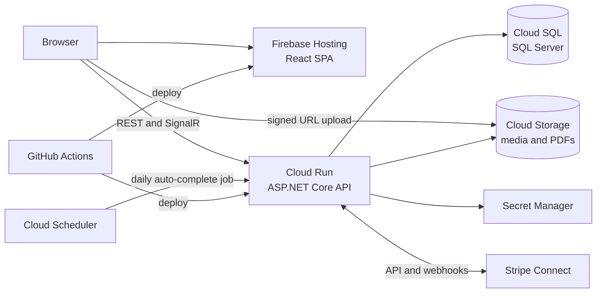

# HireNow · Technical baseline

The choices the backlog's technical tasks assume. Change them through a team decision, and record the reason here.

## Stack

| Layer | Choice | Notes |
|---|---|---|
| Frontend | React 19 + TypeScript, Vite, React Router, TanStack Query, MUI | A single-page app hosted on Firebase Hosting |
| Backend | ASP.NET Core Web API on .NET 10 (LTS), C# | Projects: `Api`, `Application`, `Domain`, `Infrastructure`, `Tests` |
| Database | SQL Server 2022 via EF Core | Local: Docker. Production: Cloud SQL for SQL Server (Express edition) |
| Authentication | ASP.NET Core Identity, bearer tokens, role policies | Roles: `Seller`, `Buyer`, `Admin` |
| Real-time | SignalR | Chat (HN-27) and notifications (HN-33) |
| Payments | Stripe Connect with Express accounts, using "separate charges and transfers"; the Stripe.net SDK | **Test mode only.** The money is held on the platform balance until the buyer approves the delivery |
| Files | Google Cloud Storage, with uploads through V4 signed URLs | Photos, videos, proof of delivery, PDFs |
| PDFs | QuestPDF | Invoices (HN-24) and contracts (HN-25, HN-26) |
| Validation | FluentValidation | |
| Tests | xUnit (backend), Vitest + React Testing Library (frontend) | Playwright end-to-end tests if time allows |
| API docs | OpenAPI (`Microsoft.AspNetCore.OpenApi`) with Swagger UI | |
| CI/CD | GitHub Actions; `google-github-actions/auth` with Workload Identity Federation | No long-lived cloud keys in GitHub |
| Hosting | Cloud Run (API container), Firebase Hosting (SPA), Cloud SQL, Cloud Storage, Secret Manager, Artifact Registry, Cloud Scheduler | One production environment. Local development uses Docker Compose |
| Logging | Structured JSON console logs, collected by Cloud Logging | |

## Architecture



## Repository layout

```
backend/            HireNow.sln, src/HireNow.{Api,Application,Domain,Infrastructure}, tests/
frontend/           Vite + React + TypeScript app
docs/               product, backlog and infrastructure docs
scripts/            tooling, such as create_github_backlog.py
.github/            issue and PR templates, workflows (added in HN-02 and HN-04)
docker-compose.yml  local SQL Server, API and frontend (added in HN-01)
```

## Practical notes

- **Cloud costs.** Cloud SQL for SQL Server is the most expensive part of the setup. New Google Cloud accounts get a $300 free trial credit, and it's worth asking your instructor about education credits. Set a budget alert (HN-03), use the smallest tier, and stop the instance when nobody is working on it.
- **Apple Silicon Macs.** The SQL Server container image is x86-64 only. In Docker Desktop, turn on "Use Rosetta for x86/amd64 emulation".
- **SignalR on Cloud Run.** Cloud Run supports WebSockets. Turn on session affinity and raise the request timeout. SignalR reconnects by itself when Cloud Run closes a long-lived connection.
- **Background jobs.** Cloud Run scales to zero, so don't rely on in-process timers. Scheduled work, such as auto-completing delivered orders in HN-22, is a protected endpoint that Cloud Scheduler calls.
- **Stripe locally.** Use the Stripe CLI to forward webhooks to your machine: `stripe listen --forward-to localhost:5000/api/webhooks/stripe`. Keep keys and webhook secrets in user secrets locally, and in Secret Manager in production.
